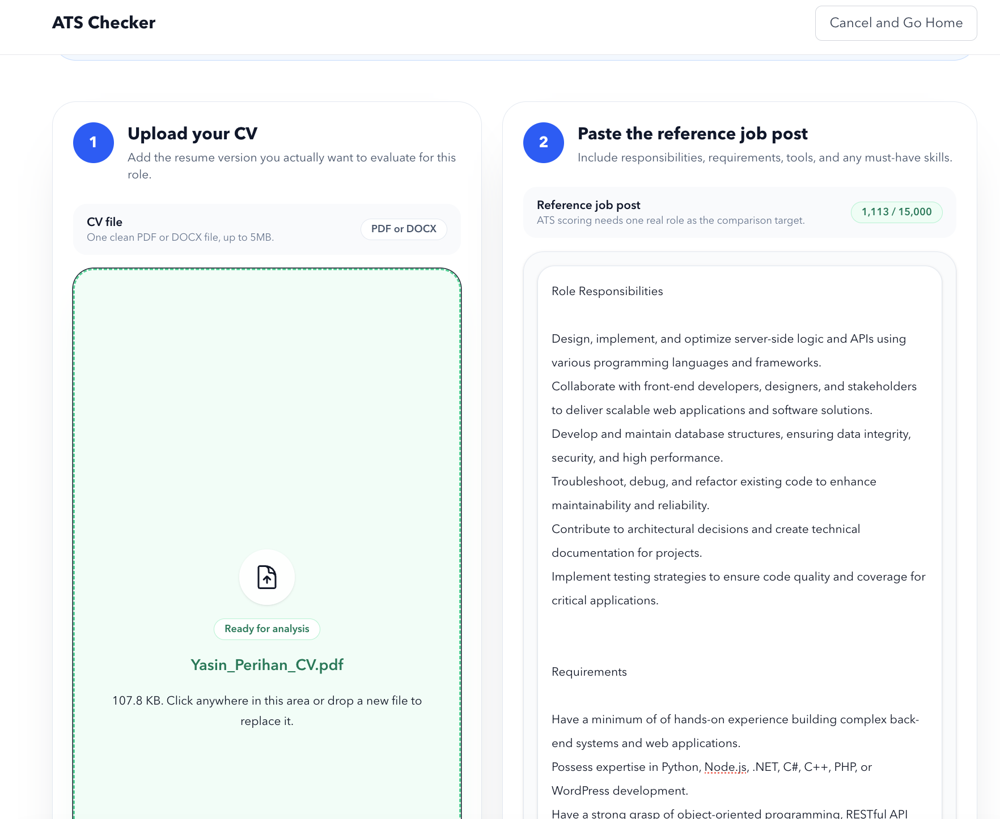
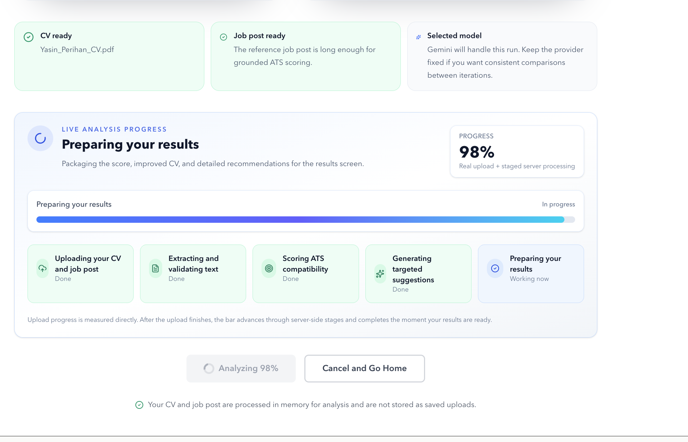
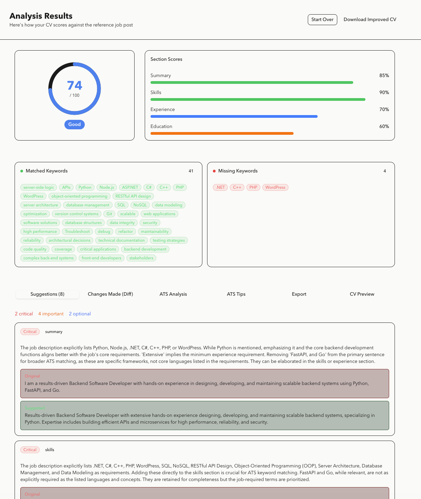

# ATS Checker

ATS Checker is a Next.js app that scores a CV against a real reference job post instead of generating a generic upload-only score. It analyzes ATS fit, highlights matched and missing keywords, suggests targeted rewrites, and lets the user export an improved version of the resume.

The app is built for role-specific resume optimization. A CV upload alone is not enough here; the current flow requires a job post so the score, rewrite suggestions, and keyword analysis stay grounded in a real target role.

## Quick Visual

### Analyze Workspace



### Live Progress



### Results Dashboard



These screenshots reflect the current job-post-based flow: upload a CV, paste a real target job post, track staged analysis progress, then review the score and rewrite suggestions.

## What The App Does

- Upload a PDF or DOCX CV
- Paste a reference job post
- Run analysis with Claude, Gemini, or OpenAI
- Show ATS score, verdict, keyword gaps, and section scores
- Generate rewrite suggestions and an improved CV
- Show a CV diff, ATS education, ATS metrics, and export tools
- Export the optimized CV as DOCX or plain text

## Main Features

- Job-post-based ATS scoring only
- Guided analyze workspace with aligned CV upload and reference job post inputs
- Readiness checks before analysis starts
- Live analysis progress with staged upload and processing feedback
- Matched and missing keyword breakdown
- Role-specific rewrite suggestions
- ATS parsing and formatting insights
- Improved CV preview and line-by-line diff
- DOCX export and plain-text export
- In-session improvement history
- Provider selector when multiple AI providers are configured

## Tech Stack

- Next.js 16
- React 19
- TypeScript
- Tailwind CSS v4
- Zustand for client state
- Recharts for score/history visualizations
- `mammoth`, `pdfjs-dist`, and `unpdf` for document parsing
- `docx` for export generation

## Getting Started

1. Install dependencies:

```bash
npm install
```

2. Copy the environment template:

```bash
cp env.example .env.local
```

3. Add at least one AI provider API key in `.env.local`

4. Start the development server:

```bash
npm run dev
```

5. Open [http://localhost:3000](http://localhost:3000)

## Environment Variables

The project reads these variables:

- `LLM_PROVIDER`
  Preferred default provider when more than one is configured.
- `ANTHROPIC_API_KEY`
  Enables Claude.
- `CLAUDE_MODEL`
  Optional Claude model override.
- `GOOGLE_API_KEY`
  Enables Gemini.
- `GEMINI_MODEL`
  Primary Gemini model.
- `GEMINI_FALLBACK_MODEL`
  Gemini fallback model if the primary model is unavailable or rate-limited.
- `OPENAI_API_KEY`
  Enables OpenAI.
- `OPENAI_MODEL`
  Optional OpenAI model override.
- `MAX_FILE_SIZE`
  Max upload size in bytes. Default is `5242880` (5 MB).

At least one provider key is required.

## Supported Inputs And Outputs

- Input formats: PDF, DOCX
- Default upload size limit: 5 MB
- Output formats: DOCX, plain text

## Available Scripts

```bash
npm run dev
npm run build
npm run start
npm run lint
```

## Notes

- CVs and job posts are processed in memory and are not stored by the app.
- If you test the app over an insecure local network URL such as `http://192.168.x.x`, Chrome may block generated downloads. Using `localhost` or HTTPS avoids that.
- The improvement history shown in the UI is session-based, not a persistent server-side history.
